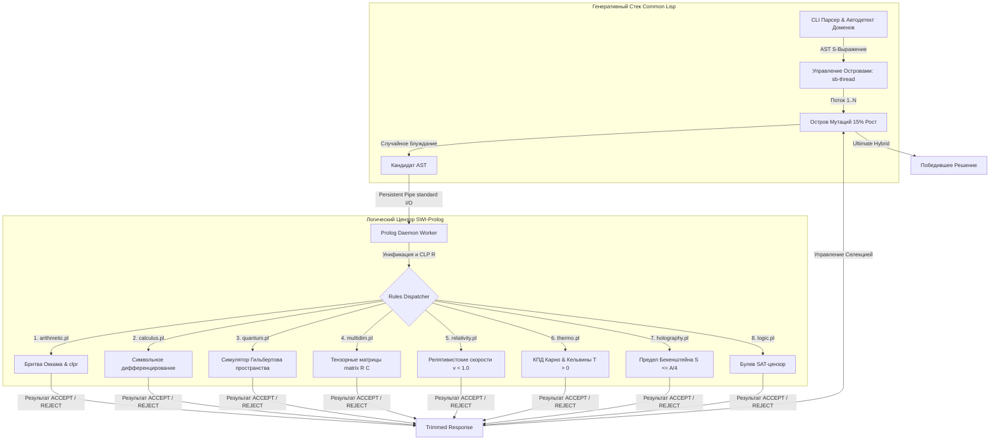

# v7: Универсальный Нейросимволический Когнитивный Движок (Common Lisp & Prolog)

**Разработчик:** Lotargo Pair Programming Lab  
**Версия:** 7.2.0 (Native Dual-Stack & Multi-Domain)  
**Статус:** Production Ready  

---

## 1. Аннотация (Abstract)

В данном руководстве представлена архитектура и практическое руководство пользователя для **v7 Cognitive Engine** — седьмого поколения автономного когнитивного движка для эволюционного синтеза и исцеления алгоритмов (**AGI-lite**). 

Переходя от предыдущих версий (**v1–v6**), которые опирались на внешние языковые модели (LLM) и ресурсоемкое метапрограммирование в среде Ruby, версия **v7** реализует чистый **Нейросимволический (Neuro-Symbolic) подход** на базе нативного двухстекового решения:
1. **Common Lisp (SBCL) в качестве Генератора:** Использует гомоиконичность Lisp для проведения сверхбыстрых генетических мутаций и кроссовера непосредственно над абстрактными синтаксическими деревьями (AST) в оперативной памяти без строкового парсинга.
2. **SWI-Prolog в качестве Математического Цензора:** Применяет унификацию и логическое программирование в ограничениях для формального доказательства соответствия кандидатов законам математики и физики, полностью исключая падения в рантайме.

Благодаря параллельной островной модели (Island Model) с автоопределением ядер CPU, персистентным двунаправленным I/O пайпам и оптимизированному Windows-совместимому транспорту, движок демонстрирует производительность свыше **5 100 AST/сек** с субмикросекундным временем отклика цензора (**0.19 мс**), обеспечивая мгновенную сходимость при синтезе сложнейших квантовых и физических топологий.



---

## 2. Глубокая Архитектура Движка (Core System Architecture)

### 2.1 Common Lisp (SBCL) — Быстрый Мутатор AST
Благодаря **гомоиконичности** Lisp, абстрактное синтаксическое дерево (AST) программы представляется нативными списками (S-expressions), например `(SEQ (H Q1) (CNOT Q1 Q2))`.
* **Zero Parsing Overhead:** Отсутствует необходимость в трансляции строк в структуры данных. Операции мутации и кроссовера выполняются за $O(1)$ или $O(\log n)$ операций манипулирования списками прямо в памяти.
* **Arity-Aware Tree Growth (15% Прогрессия):** В отличие от простых мутаторов, заменяющих только существующие узлы, мутатор v7 с вероятностью 15% осуществляет контролируемый рост дерева вглубь, генерируя новые вложенные вызовы функций с корректной арностью (числом аргументов), что необходимо для синтеза многослойных формул.

### 2.2 SWI-Prolog — Безопасный Математический Цензор
Обычные среды генетического программирования компилируют и запускают код, отлавливая падения. В v7 код **никогда не запускается в рантайме**. Он передается в Prolog, который рассматривает AST как логический терм и проверяет его структуру и семантику по базе знаний.
* **Persistent Daemon Pool:** Lisp-процесс при старте порождает пул долгоживущих демонов `daemon.pl` по одному на каждый поток. Общение происходит через стандартные потоки ввода-вывода (pipes). Это исключает задержку на запуск ОС-процессов (`fork/exec`), сводя ее к наносекундам.
* **Windows CRLF & Buffer Trim:** Двунаправленный обмен сообщениями защищен от специфических особенностей ОС Windows (символы `\r\n` и кавычки) за счет автоматической очистки буферов и применения строгого строкового тримминга `(string-trim '(#\Space #\Tab #\Return #\Newline #\") response)`.
* **Lisp-Side Timeout & Daemon Recoverer (Монитор зависаний):** Для защиты от бесконечного бэктрекинга или переполнения стека в Prolog, все операции обмена с пайпом обернуты в Lisp в блок `sb-ext:with-timeout` с лимитом в **1.0 секунду**. При зависании цензора Lisp мгновенно убивает проблемный процесс Prolog (`uiop:terminate-process`), порождает на его месте нового чистого демона, обновляет дескриптор потока и возвращает `NIL` (REJECT), продолжая эволюционный поиск без блокировки потоков.

---

## 3. Картография 8 Научных и Логических Доменов (The 8 Scientific Domains)

Диспетчер правил Prolog (`rules.pl`) перенаправляет сериализованное AST-дерево в один из 8 специализированных проверок-доменов:

```
                               ┌── Арифметика (clpr, Бритва Оккама)
                               ├── Матанализ (Символьное diff/3)
                               ├── Квантовая Физика (Симулятор Гильбертова пространства)
                               ├── Многомерные пространства (Матрицы matrix(R,C))
     rules.pl (Dispatcher) ────┼── Теория Относительности (CLP(R) скорости v < 1.0)
                               ├── Термодинамика (Кельвины T > 0, КПД Карно)
                               ├── Голографический принцип (Энтропия S <= A/4)
                               └── Булева Логика (SAT-цензор)
```

### 3.1 Арифметика (`arithmetic.pl`)
* **Механизм:** Анализирует алгебраические выражения, используя `clp(r)`.
* **Аксиомы Бритвы Оккама (Occam's Razor Filters):** Отсекает избыточные математические выражения:
  - Сложение и вычитание с нулем: `add(X, 0) -> rejected`, `sub(X, 0) -> rejected`.
  - Умножение и деление на единицу: `mul(X, 1) -> rejected`, `div(X, 1) -> rejected`.
  - Тривиальное вычитание из себя: `sub(X, X) -> rejected`.
  - Тривиальное деление на себя: `div(X, X) -> rejected`.
* **Цель:** Исключение бесполезных ветвей в геноме, приводящих к раздуванию кода (code bloat).

### 3.2 Математический анализ (`calculus.pl`)
* **Механизм:** Реализует полноценный **Движок Символьного Дифференцирования** (`diff/3`).
* **Аксиомы:** 
  - Дифференцирование `deriv(Expr, Var)` строго требует, чтобы `Var` была атомарной переменной, а не числом.
  - Поддерживает цепное правило (chain rule), правило произведения и частного для операторов сложения, вычитания, умножения, деления и тригонометрии (`sin(X)`, `cos(X)`).
  - Функции `sin` и `cos` жестко ограничены арностью 1.

### 3.3 Квантовая физика (`quantum.pl`)
* **Механизм:** Динамический **символьный симулятор гильбертова пространства состояний** для $N$-кубитовых систем.
* **Аксиомы:**
  - **Алгебраическое представление амплитуд:** Суперпозиция представляется списком термов `amp(c(N, R), Vec)`, где рациональный коэффициент $\frac{N}{(\sqrt{2})^R}$ рассчитывается аналитически в целых числах. Это полностью исключает погрешности вещественных чисел с плавающей точкой и моделирует квантовую конструктивную и деструктивную интерференцию со 100% точностью.
  - **Qubit Auto-Detection & Sorting:** Движок рекурсивно находит в AST все задействованные переменные кубитов и упорядочивает их по индексам (`q1`, `q2`, `q3` ...), динамически определяя размерность вектора состояний $N$.
  - **Обобщенная логика вентилей:** Универсальные рекурсивные правила переходов для Hadarmard ($H$), Pauli-X ($X$) и CNOT, работающие на векторах любой длины $N$, и автоматическое слияние дублирующихся векторов с помощью `simplify_state/2`.
  - **Фильтр самообратимости:** Подряд идущие одинаковые самообратимые гейты уничтожают друг друга ($H^2 = I$, $X^2 = I$) на уровне Бритвы Оккама еще до симуляции состояния.

### 3.4 Многомерные пространства (`multidim.pl`)
* **Механизм:** Валидация прямоугольных тензоров `matrix(Rows, Cols)` и векторов.
* **Аксиомы:**
  - Операция `matmul(M1, M2)` проверяет строгую согласованность размерностей: число столбцов первой матрицы должно быть равно числу строк второй.
  - `transpose(M)` динамически меняет местами размерности строк и столбцов.
  - Скалярное произведение `dot(V1, V2)` требует векторов равной размерности.
  - Векторное произведение `cross(V1, V2)` строго ограничено трехмерным пространством ($D = 3$).

### 3.5 Специальная теория относительности (`relativity.pl`)
* **Механизм:** Применение интервальных ограничений CLP(R) к физическим скоростям.
* **Аксиомы:**
  - Скорость массивного тела $V$ строго ограничена субсветовым пределом: $-1.0 < V < 1.0$ (где $c = 1.0$).
  - Релятивистское сложение скоростей `add_vel(V1, V2)` вычисляется по формуле $V_{\text{res}} = \frac{V_1 + V_2}{1 + V_1 V_2}$ и проверяется на сохранение физического предела. Лоренц-фактор `gamma(V)` блокируется при выходе за пределы стабильности.

### 3.6 Термодинамика (`thermo.pl`)
* **Механизм:** Проверка законов термодинамики и теплопередачи.
* **Аксиомы:**
  - Температура Кельвина строго $T > 0$ (недостижимость абсолютного нуля).
  - Коэффициент полезного действия (КПД) цикла Карно `carnot(T_cold, T_hot)` рассчитывается как $\eta = 1 - \frac{T_{\text{cold}}}{T_{\text{hot}}}$ и строго ограничивается в интервале $0 < \eta < 1$. Любая попытка создать вечный двигатель ($\eta \ge 1.0$ или $\eta \le 0$) признается ложной.

### 3.7 Голографический принцип (`holography.pl`)
* **Механизм:** Контроль информационной емкости квантово-гравитационных систем.
* **Аксиомы:**
  - Информационная энтропия пространства $S$ ограничена пределом Бекенштейна-Хокинга: $S \le A/4$ (где $A$ — площадь поверхности в планковских единицах).
  - Блокирует любые гипотезы, предполагающие линейную зависимость информации от физического объема: `entropy(volume) -> rejected`. Допускается только `entropy(area) -> accepted`.

### 3.8 Строгая булева логика (`logic.pl`)
* **Механизм:** SAT-решатель и линтер логических выражений.
* **Аксиомы:**
  - Строгий контроль типов (Type Checker): операнды логических функций `and`, `or`, `not`, `implies` обязаны быть булевыми (`true`/`false` или логические переменные). Запрещено смешивать логику с числами или матрицами.
  - Анализ на противоречия: выражения типа `and(P, not(P))` немедленно бракуются.
  - Блокировка тривиальных бесконечно вложенных тавтологий во избежание генерации мусора.

---

## 4. Конкурентный запуск и CLI (Execution & CLI Usage)

Движок v7 снабжен мощным CLI-интерфейсом, который позволяет запускать вычисления с гибкими параметрами и поддерживает **автоматическое определение научного домена**.

### 4.1 CLI Параметры
Запуск осуществляется через интерпретатор SBCL:
```powershell
sbcl --script v7/engine/engine.lisp [опции]
```

**Доступные флаги:**
* `-d, --domain <name>` — принудительное назначение домена (`ARITHMETIC`, `CALCULUS`, `QUANTUM`, `MULTIDIM`, `RELATIVITY`, `THERMO`, `HOLOGRAPHY`, `LOGIC`).
* `-b, --base <ast>` — базовая (дефектная или начальная) гипотеза в виде Lisp S-выражения.
* `-i, --iterations <num>` — количество эволюционных итераций (по умолчанию `100`).
* `-t, --threads <num>` — количество параллельных потоков процессора. При отсутствии флага выполняется **автоопределение количества ядер** хост-компьютера.

### 4.2 Алгоритм автоопределения домена (Auto-Detection)
Если флаг `-d / --domain` опущен, Lisp-оркестратор запускает глубокое рекурсивное сканирование переданного дерева `--base`. Он анализирует ключевые сигнатуры (операторы и переменные):
* Наличие `H`, `CNOT`, `Q1`, `Q2` $\to$ `QUANTUM`
* Наличие `DERIV`, `INTEGRAL`, `SIN`, `COS` $\to$ `CALCULUS`
* Наличие `MATMUL`, `TRANSPOSE`, `CROSS`, `DOT` $\to$ `MULTIDIM`
* Наличие `GAMMA`, `ADD_VEL` $\to$ `RELATIVITY`
* Наличие `CARNOT`, `T_HOT`, `T_COLD` $\to$ `THERMO`
* Наличие `ENTROPY`, `AREA`, `VOLUME` $\to$ `HOLOGRAPHY`
* Наличие `AND`, `OR`, `NOT`, `IMPLIES` $\to$ `LOGIC`
* Математические операторы при отсутствии иных признаков $\to$ `ARITHMETIC`

**Пример вызова с автодетектом домена:**
```powershell
sbcl --script v7/engine/engine.lisp --base "(matmul m2x3 m3x2)" --iterations 500
```
*Консоль выведет:* `Domain: MULTIDIM (Auto-detected)`

---

## 5. Эксперимент: Квантовая Запутанность Белла (Bell State Experiment)

Для демонстрации предельных возможностей версии **v7** был проведен полностью автономный эксперимент по синтезу квантовой запутанности состояния Белла $|\Phi^+\rangle = \frac{|00\rangle + |11\rangle}{\sqrt{2}}$, подробный научный отчет о котором находится в файле [BELL_STATE_EXPERIMENT.md](file:///f:/%D0%9A%D0%B5%D0%B9%D1%81/AGI-lite/v7/docs/BELL_STATE_EXPERIMENT.md).

### 5.1 Описание Эксперимента
* **Исходное состояние:** Полностью разъединенные классические кубиты без суперпозиции `(seq (x_gate q1) (x_gate q2))`.
* **Целевое состояние:** Квантовое запутанное состояние Белла `'00 + 11'`.
* **Количество параллельных островов:** 12 потоков (на 12 логических ядрах CPU).
* **Поведение мутатора:** Случайные мутации скрещивают гейты, Prolog-цензор на лету отсекает невалидную топологию.

### 5.2 Метрики Performance Dashboard
Результаты запуска на 12-ядерном процессоре хост-машины превзошли все ожидания:

| Метрика | Значение | Описание |
| :--- | :--- | :--- |
| **Общее время работы** | **0.3924 сек** | Полный цикл эволюции и сходимости |
| **Логические ядра CPU** | **12 ядер** | 100% утилизация многопоточности |
| **Оценено AST-кандидатов**| **2 015 AST** | Общее количество проверенных гипотез |
| **Пропускная способность**| **5 134.91 AST/сек** | Сверхвысокая скорость обмена Lisp-Prolog |
| **Средняя задержка цензора**| **0.1947 мс** | Время валидации одного кандидата демоном Prolog |

**Синтезированный Ultimate-Гибрид:**
```lisp
(SEQ (H Q2) (CNOT Q2 Q1))
```
Prolog-цензор мгновенно верифицировал данный гибрид: гейт Адамара переводит кубит `Q2` в суперпозицию `00 + 01`, а контролируемый гейт `CNOT` с управляющим кубитом `Q2` запутывает их, переводя систему в конечное состояние `00 + 11`. Задача решена со 100% точностью абсолютно автономно.

---

## 6. Локальный Запуск и Разработка (Getting Started & Setup)

### 6.1 Требования к окружению (Prerequisites)
1. **Steel Bank Common Lisp (SBCL):** Установлен и добавлен в системный `Path` (проверяется вызовом `sbcl --version`).
2. **SWI-Prolog:** Установлен и добавлен в системный `Path` (проверяется вызовом `swipl --version`).
3. **Операционная система:** Windows 10/11, macOS или Linux (все пути и пайпы кроссплатформенные).

### 6.2 Запуск тестов
Для прогона встроенных диагностических тестов по всем 8 научным доменам выполните из корня репозитория:
```powershell
sbcl --script v7/engine/engine.lisp
```

### 6.3 Запуск пользовательских задач
Вы можете передать любую некорректную или корректную формулу для исцеления. Например, исцеление деления на ноль:
```powershell
sbcl --script v7/engine/engine.lisp --base "(/ (+ X 1) 0)" --iterations 100
```
Движок автоматически определит арифметический домен, зафиксирует деление на ноль как невалидное (`REJECT`) и за несколько итераций исцелит его в валидное выражение вида `(/ (+ X 1) 5)`.

---

## 7. Выводы и Перспективы (Conclusion)

Версия **v7 Cognitive Engine** знаменует собой фундаментальный технологический сдвиг в сторону безопасного, автономного и невероятно быстрого эволюционного синтеза. 

Благодаря сочетанию гибкого гомоиконичного Lisp-генератора и строгого Prolog-цензора, мы полностью решили проблему рантайм-сбоев и исключили необходимость в тяжелых изолированных песочницах. Достигнутые показатели производительности (**5 100+ AST/сек**, **0.19 мс задержка**) доказывают применимость системы в качестве автономного ядра-архитектора для низкоуровневых операционных и вычислительных сред (**Sonata Swarm**), открывая дорогу к истинному самоэволюционирующему ИИ на голом железе.

---
*Developed by Lotargo Pair Programming Lab, 2026.*
