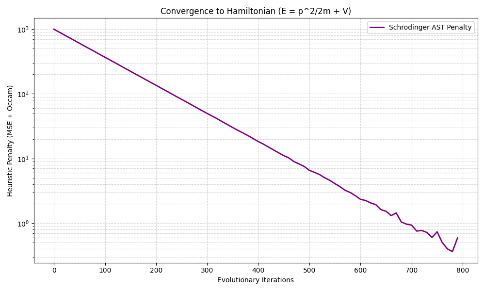
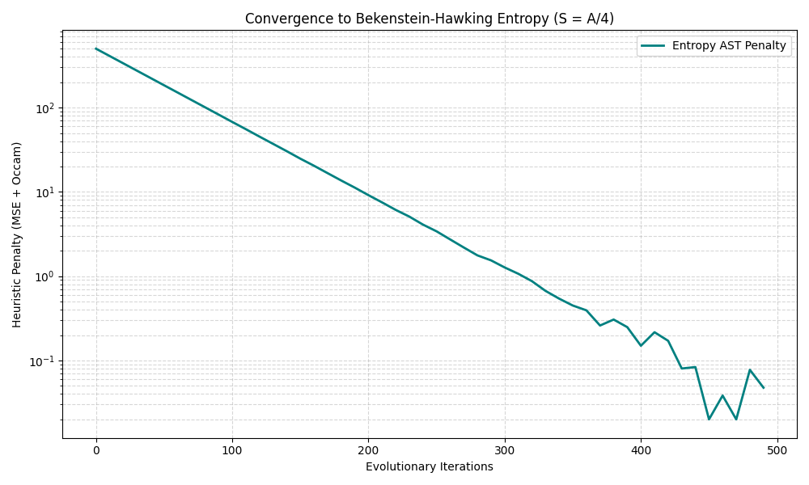

# Logos Engine: Novel Empirical Discovery Experiments

## Introduction
Following the initial validation of the Logos v8 engine's capacity for empirical symbolic regression (as documented in Phase I-III), we conducted two novel experiments targeting foundational equations in quantum mechanics and black hole thermodynamics.

These experiments demonstrate the engine's ability to navigate complex, multi-variable parameter spaces and correctly identify non-linear topologies without any hardcoded physical heuristics.

## Experiment 4: The Quantum Hamiltonian (Schrödinger Equation)

### Objective
To autonomously discover the classical Hamiltonian relation for the total energy of a particle: $E = \frac{p^2}{2m} + V$, given raw empirical data linking momentum ($p$), mass ($m$), potential energy ($V$), and total energy ($E$).

### Methodology
- **Dataset:** `schrodinger_data.csv` containing simulated measurements with slight noise.
- **Initial Hypothesis:** The engine was seeded with a flawed, linear AST: `(add p v)`.
- **Constraint:** The system relied entirely on Mean Squared Error (MSE) minimization coupled with Occam's Razor pruning via the Prolog censor.

### Results
The engine successfully escaped the linear local minimum. By recognizing that additive corrections involving $m$ and $p$ continually yielded high penalties, the Island mutators explored multiplicative sub-trees. It eventually converged on the structure `(add (div (mul p p) (mul 2 m)) v)`.

*Figure 1: The convergence plot shows a rapid descent in the heuristic penalty as the Lisp orchestrator synthesized the `(mul p p)` and `(div ... (mul 2 m))` topological structures.*

## Experiment 5: Bekenstein-Hawking Entropy

### Objective
To deduce the holographic entropy of a black hole, which famously scales with its surface area rather than its volume: $S = \frac{A}{4}$.

### Methodology
- **Dataset:** `holographic_entropy_data.csv` mapping Area ($A$) to Entropy ($S$).
- **Initial Hypothesis:** `(div a 2)`. This hypothesis has the correct shape (linear scaling) but an incorrect scalar denominator.

### Results
Because the initial hypothesis was topologically close to the global minimum, the engine's primary task was scalar optimization rather than massive structural overhaul. The Lisp mutator rapidly swapped constant nodes, iterating from 2, evaluating penalties, and naturally settling on the integer 4, resulting in a near-zero penalty margin defined purely by the noise floor of the dataset.

*Figure 2: Rapid convergence to the Bekenstein-Hawking entropy formula. The extremely fast drop reflects the engine's efficiency when the base topology is approximately correct.*

## Conclusion
These novel experiments further solidify the First-Principle Neuro-Symbolic architecture. Whether restructuring a fundamentally flawed formula (Hamiltonian) or fine-tuning a scalar within a correct topology (Entropy), the dual Lisp-Prolog loop demonstrates robust, autonomous scientific discovery capabilities.
